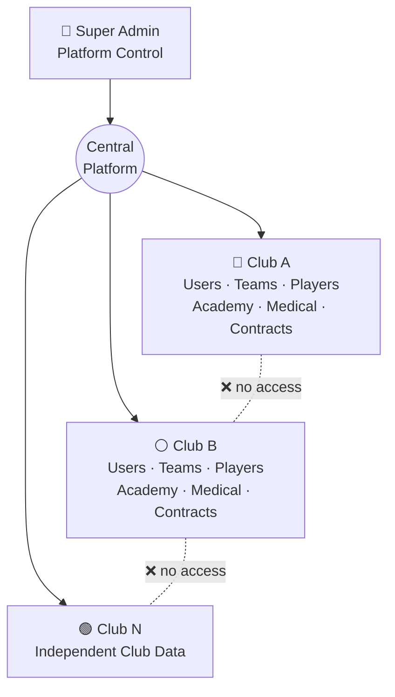
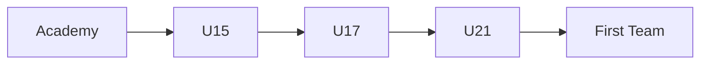
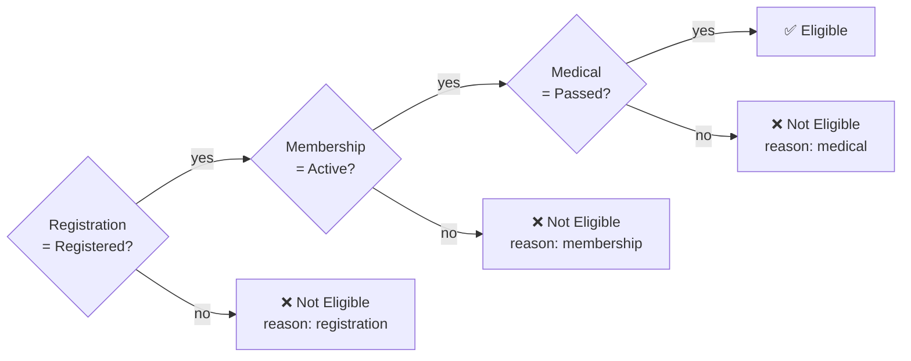
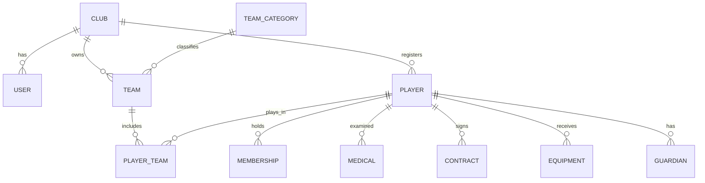

<div align="center">

# ⚽ Egypt Football Club Management System
### نظام إدارة الأندية الكروية المصرية

**One platform. Multiple clubs. Isolated data. Centralized management.**

[](https://www.python.org/)
[](https://nicegui.io/)
[](https://www.sqlite.org/)
[](#-multi-tenant-architecture)
[](#-ui--ux)
[](#-development-status)

<br>

A modern, secure, **multi-tenant** platform that gives every Egyptian football club its own
digital headquarters, covering players, teams, academies, medical, contracts, memberships and
equipment, all under one roof and with **zero data leakage between clubs**.

[Features](#-features) •
[Architecture](#-multi-tenant-architecture) •
[Roles](#-roles--permissions) •
[Quick Start](#-quick-start) •
[Roadmap](#-roadmap)

</div>

---

## 🇪🇬 نبذة بالعربية

نظام متكامل لإدارة الأندية الكروية في مصر، مبني بمعمارية **متعددة العملاء (Multi-Tenant)**:
منصة واحدة تخدم عدة أندية، وكل نادٍ له بياناته المعزولة تمامًا عن باقي الأندية.

يشمل النظام: **اللاعبين، الفرق، الأكاديميات، الأجهزة الفنية، السجلات الطبية، العقود والرواتب،
العضويات، القيد والتسجيل، المهمات الرياضية، والإحصائيات**، مع واجهة عربية كاملة (RTL) بخط **Cairo**
ولوحات تحكم حديثة.

---

## 📑 Table of Contents

- [Why This Project](#-why-this-project)
- [Features](#-features)
- [Multi-Tenant Architecture](#-multi-tenant-architecture)
- [Roles & Permissions](#-roles--permissions)
- [Core Modules](#-core-modules)
- [Smart Player Eligibility](#-smart-player-eligibility)
- [Dashboards](#-dashboards)
- [Security](#-security)
- [Database](#-database)
- [Tech Stack](#-tech-stack)
- [Project Structure](#-project-structure)
- [Quick Start](#-quick-start)
- [Configuration](#-configuration)
- [Development Status](#-development-status)
- [Roadmap](#-roadmap)
- [Contributing](#-contributing)
- [License](#-license)

---

## 🎯 Why This Project

Running a football club means juggling a huge amount of sporting, medical, administrative and
financial data, usually scattered across spreadsheets, paper files and chat groups.

This platform brings everything into **one system** where:

- 🏟️ every club feels like it owns a **dedicated management system**
- 🔒 data is **strictly isolated** per club, enforced in code and not only in the UI
- 🧠 player status is **computed automatically** from registration, membership and medical data
- 🌍 the whole experience is built for **Arabic-speaking** football organizations

---

## ✨ Features

| | Module | What it gives you |
|---|---|---|
| 🏢 | **Club Management** | Arabic/English names, logo, activation control |
| 👥 | **Teams** | First Team down to U10, rosters, coaches, seasons |
| 🎓 | **Academies** | Branches, capacities, subscriptions, separate from competitive teams |
| 🧑‍🎓 | **Players** | Full 360° profile: personal, sporting, medical, financial |
| 🩺 | **Medical** | Examinations, injuries, eligibility, doctor notes |
| 📝 | **Registrations & Memberships** | Status tracking with expiry awareness |
| 💰 | **Contracts & Salaries** | Monthly/annual pay, bonuses, incentives, expiry |
| 👕 | **Equipment & Measurements** | Kit sizes, assigned items, returns, condition |
| 🧑‍🏫 | **Coaches & Staff** | Head/assistant/GK/fitness coaches, analysts, team assignment |
| 📊 | **Dashboards & Stats** | Per-club and platform-wide analytics |
| 🔎 | **Search & Filters** | Find any player in seconds by name, ID, team, status... |

---

## 🏗️ Multi-Tenant Architecture

> **One platform. Multiple football clubs. Completely isolated data.**



Every club-related record carries its **club identifier**:

```text
Club
 ├── Users
 ├── Teams
 ├── Players
 ├── Academies
 ├── Coaches
 ├── Medical Records
 ├── Contracts
 ├── Memberships
 └── Equipment
```

**Isolation is enforced in the application's database queries and business logic**, not just by
hiding things in the interface. A Club Admin physically cannot read or modify another club's
records.

---

## 🔐 Roles & Permissions

| Role | Scope | Responsibilities |
|---|---|---|
| 👑 **Super Admin** | Platform | Create/manage/activate/deactivate clubs, platform statistics and settings |
| 🏛️ **Club Admin** | Own club | Full management of the club: teams, players, academies, staff, memberships, registrations, medical, contracts, equipment |
| 🧑‍🏫 **Coach** | Assigned teams | View teams & players, positions, sporting info, monitor performance |
| 🩺 **Medical Staff** | Medical data | Examinations, eligibility, injuries, measurements, health status |
| 💼 **Finance** | Financial data | Contracts, salaries, bonuses, incentives, expiry tracking |

---

## 🧩 Core Modules

### 👥 Teams & Age Categories

```text
First Team · U23 · U21 · U19 · U18 · U17 · U16 · U15 · U14 · U13 · U12 · U10
```

Each team has: name, category, season, player count, max roster size, head coach,
assistant coaches and status. Categories are extensible per club.

### 🎓 Academies

Academy name · branch · age category · coach · player count · capacity · subscription status.

Academies are modeled **separately from competitive teams**, because capacity and management
rules are different.

### 🧑‍🎓 Players

<details>
<summary><b>Personal information</b></summary>

Full name · National ID · Date of birth · Calculated age · Gender · Phone · Email · Address · Marital status

</details>

<details>
<summary><b>Sporting information</b></summary>

Club · Team · Age category · Position · Preferred foot · Level · Years of experience · Joining date · Status

**Preferred foot:** `Right` · `Left` · `Both`

**Positions:**
`Goalkeeper` · `Center Back` · `Right Back` · `Left Back` · `Defensive Midfielder` ·
`Central Midfielder` · `Attacking Midfielder` · `Right Winger` · `Left Winger` · `Striker`

</details>

<details>
<summary><b>Classification & development path</b></summary>

`First Team` · `Youth Team` · `Academy` · `Amateur` · `Practitioner`



Historical team and registration records preserve the player's full development history.

</details>

### 📋 Statuses at a glance

| Type | Values |
|---|---|
| **Registration** | Registered · Not Registered · Pending · Suspended · Expired |
| **Membership** | Active · Expired · Suspended · Pending · Cancelled |
| **Player** | Active · Injured · Suspended · Transferred · Retired |
| **Medical** | Passed · Failed · Pending |

### 🩺 Medical

Examination date, type and result · medical status · injuries · physical measurements ·
doctor notes · responsible doctor · medical eligibility.
Medical data is kept **separate** from general player information.

### 💰 Contracts & Salaries

Contract type · start/end dates · monthly, annual and maximum salary · bonuses · incentives · status.

```text
First Team Player    | 50,000 EGP / Month
U21 Player           | 15,000 EGP / Month
Academy Player       | No Salary
```

### 👕 Measurements & Equipment

- **Measurements:** shirt, shorts, jacket and shoe sizes, height, weight, body measurements.
- **Equipment:** item name/type, quantity, delivery date, return date, condition.

```text
2 × Match Shirts   ·   1 × Football Boots   ·   1 × Training Suit   ·   2 × Shorts
```

### 🧑‍🏫 Coaches & Technical Staff

Head Coach · Assistant Coach · Goalkeeper Coach · Fitness Coach · Performance Analyst · Medical Staff,
each linked to specific teams and responsibilities.

---

## ✅ Smart Player Eligibility

Eligibility is **calculated**, not typed in by hand. The system combines registration, membership
and medical state, and explains the reason when a player is blocked.



```text
Registration: Registered   Membership: Active   Medical: Passed  →  ✅ Eligible
Registration: Registered   Membership: Active   Medical: Failed  →  ❌ Not Eligible (medical)
```

---

## 📊 Dashboards

### 🏛️ Club Dashboard
Total players · first-team / youth / academy players · teams · coaches · registered players ·
active memberships · medical statistics · eligible vs. ineligible · injured players ·
monthly and annual salaries.

### 👑 Super Admin Dashboard
Total clubs, players, teams, academies and coaches · players by club / age category / position ·
registration, membership, medical and salary statistics · average salaries, all **without
exposing any individual club's private data**.

### ⚽ Football Statistics
Players by position, team and age category · goalkeepers, defenders, midfielders, wingers,
strikers · roster distribution and team roster statistics.

---

## 🔎 Search & Filtering

Filter players by **name · National ID · team · age · position · registration status ·
membership status · medical status · eligibility**.

---

## 🛡️ Security

| # | Principle |
|---|---|
| 1 | Role-based access: users only see what their role permits |
| 2 | Club Admins can never reach another club's records |
| 3 | Every club-related record is bound to the correct club |
| 4 | **Parameterized SQL queries** everywhere |
| 5 | Permission checks run **before** administrative operations |
| 6 | No credentials in source code |
| 7 | Passwords are securely **hashed** |
| 8 | Tenant isolation enforced in **business logic**, not just the UI |

---

## 🗄️ Database

SQLite today, organized around lookup tables and relational entities with foreign keys for
integrity.

```text
Club · User · Player · Team · Sport · Team Category · Tournament · Membership
Medical · Guardian · Equipment · Contracts · Registrations · Player-Team Relationships
```



> The diagram is a simplified overview. See `database.py` for the full schema.

---

## 🧰 Tech Stack

| Layer | Technology |
|---|---|
| Language | Python |
| UI Framework | NiceGUI |
| Database | SQLite + SQL |
| Frontend | HTML / CSS |
| Version Control | Git & GitHub |

### 🎨 UI & UX
RTL layout · full Arabic interface · **Cairo** font · responsive components · modern dashboards ·
searchable tables · statistics cards · football-oriented visual design.

---

## 📁 Project Structure

```text
egypt-football-club-management/
│
├── main.py                 # App entry point
├── database.py             # Schema & data access
├── business_logic.py       # Rules, eligibility, tenant isolation
├── theme.py                # Colors, fonts, RTL styling
├── requirements.txt
├── run.bat
│
├── components/             # Reusable UI building blocks
│   ├── cards.py
│   ├── layout.py
│   └── tables.py
│
└── pages/                  # One file per module
    ├── landing.py          ├── login_page.py        ├── dashboard_page.py
    ├── clubs_page.py       ├── teams_page.py        ├── players_page.py
    ├── academies_page.py   ├── coaches_page.py      ├── medical_page.py
    ├── contracts_page.py   ├── registrations_page.py├── memberships_page.py
    ├── equipment_page.py   └── statistics_page.py
```

---

## 🚀 Quick Start

```bash
# 1. Clone
git clone https://github.com/YOUR_USERNAME/egypt-football-club-management.git
cd egypt-football-club-management

# 2. Virtual environment (Windows)
python -m venv venv
venv\Scripts\activate

# 3. Install
pip install -r requirements.txt

# 4. Run
python main.py
```

Open 👉 **http://localhost:8080**

> On Windows you can also just double-click `run.bat`.

---

## ⚙️ Configuration

Keep secrets **outside** the source code, using environment variables:

| Variable | Purpose |
|---|---|
| `DATABASE_URL` | Database location |
| `SECRET_KEY` | Application secret |
| `STORAGE_SECRET` | Session storage secret |

> ⚠️ **Never** commit passwords, API keys or secret keys to GitHub.

---

## 🚧 Development Status

- [x] Authentication
- [x] Multi-tenant architecture
- [x] Club management
- [x] Dashboard
- [x] Team management
- [x] Player management foundation
- [x] Membership management
- [ ] Complete academy management
- [ ] Complete coach management
- [ ] Complete medical management
- [ ] Complete contract management
- [ ] Registration management
- [ ] Equipment management
- [ ] Advanced statistics
- [ ] Complete role-based permissions
- [ ] Audit logging
- [ ] Production deployment

---

## 🗺️ Roadmap

| Phase | Focus | Highlights |
|---|---|---|
| **Next** | Operations | Contract expiry notifications · medical alerts · injury history · transfer history |
| **Soon** | Reporting | PDF reports · Excel exports · notifications · audit logs |
| **Later** | Football analytics | Attendance · training · match management · goals, assists, minutes, cards, ratings · scouting |
| **Vision** | Ecosystem | Advanced permissions · REST API · cloud deployment · mobile app |

---

## 🤝 Contributing

Contributions, ideas and bug reports are welcome.

1. Fork the repository
2. Create a branch: `git checkout -b feature/your-feature`
3. Commit your changes: `git commit -m "Add your feature"`
4. Push: `git push origin feature/your-feature`
5. Open a Pull Request

> Please make sure every new query respects **tenant isolation** (always scope by club).

---

## 🌟 Long-Term Vision

To build the complete digital infrastructure for football club management in Egypt, connecting
administration, sporting operations, medical departments, finance, academies and player
management in one system, while keeping strict separation between clubs.

---

## 📄 License

Currently intended for development and educational purposes.
A formal open-source license may be added in a future release.

---

<div align="center">

**⚽ Egypt Football Club Management System**

*One platform. Multiple clubs. Isolated data. Centralized management.*

Built with ❤️ for Egyptian football.

</div>
